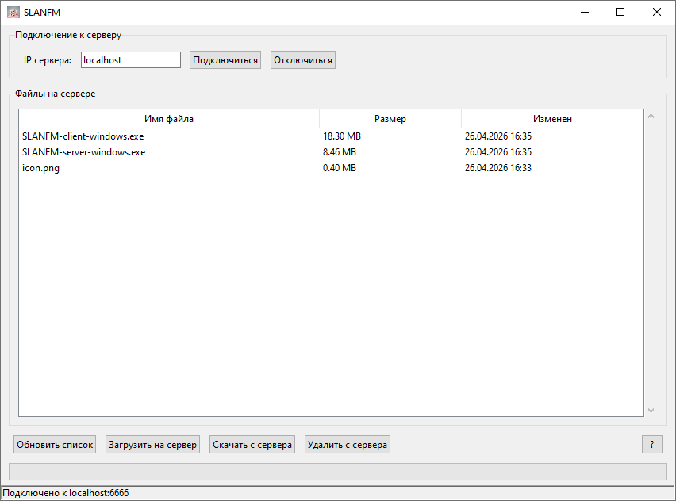
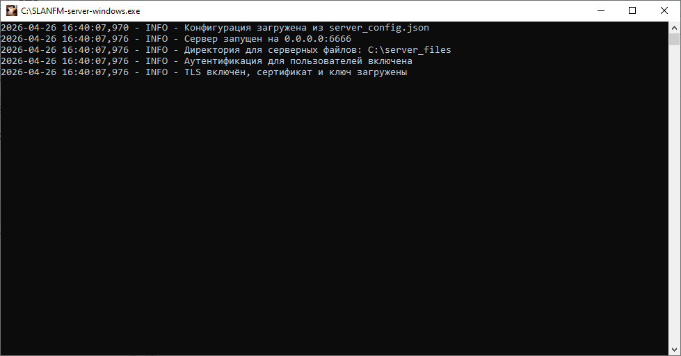

<h1 align="center"><b>SLANFM</b></h1>

<h4 align="center"><b>Простое клиент-серверное приложение для передачи файлов.</b></h4>

<h5 align="center">

**Русский** | [English](./l10n/README-en.md)

</h5>

## Установка и запуск

1. Перейдите на [страницу релизов](https://github.com/Sandile225325/SLANFM/releases) и скачайте последние версии архивов:
   - `SLANFM-client-windows.zip` – клиент;
   - `SLANFM-server-windows.zip` – сервер.

2. Распакуйте каждый архив.

3. Запустите `SLANFM-server-windows.exe` для хостинга сервера.

4. Запустите `SLANFM-client-windows.exe` для использования клиента.

**ИЛИ**

1. Клонируйте репозиторий и перейдите в его корневую папку:

   ```
   git clone -b next https://github.com/Sandile225325/SLANFM.git
   cd SLANFM
   ```

2. Установите необходимые библиотеки:

   ```
   pip install -r requirements.txt
   ```

3. Запуск сервера:

   ```
   python server/server.py
   ```

4. Запуск клиента:
   ```
   python client/gui.py
   ```

## Настройка

### Сервер

Конфигурация сервера хранится в файле **`server/server_config.json`**.

| Параметр                              | Тип     | Описание                                                                                                        |
| ------------------------------------- | ------- | --------------------------------------------------------------------------------------------------------------- |
| `host`                                | string  | IP-адрес для прослушивания (`0.0.0.0` — все интерфейсы)                                                         |
| `port`                                | number  | Порт, на котором работает сервер                                                                                |
| `upload_dir`                          | string  | Путь для хранения файлов (может быть относительный или абсолютный)                                              |
| `max_file_size`                       | number  | Максимальный размер загружаемого файла в байтах                                                                 |
| `chunk_size`                          | number  | Размер блока данных при передаче в байтах                                                                       |
| `timeout`                             | number  | Таймаут сокета в секундах                                                                                       |
| `can_clients_delete_files`            | boolean | Разрешать ли клиентам удаление файлов                                                                           |
| `auth_token`                          | string  | Токен для аутентификации клиентов. Если пустая строка или только пробелы — аутентификация не требуется          |
| `tls_enabled`                         | boolean | Использовать ли шифрование TLS. Если `false`, параметры `cert_file` и `key_file` игнорируются                   |
| `cert_file`                           | string  | Путь к файлу сертификата (необходим для работы TLS)                                                             |
| `key_file`                            | string  | Путь к файлу приватного ключа (необходим для работы TLS)                                                        |
| `max_json_size`                       | number  | Максимальный размер JSON-команды в байтах. Допустимый диапазон: `1024`–`67108864`                               |
| `auth_rate_limit_enabled`             | boolean | Использовать ли защиту от брутфорса токена                                                                      |
| `auth_rate_limit_max_attempts`        | number  | Сколько неудачных попыток аутентификации с одного IP допускается за окно `auth_rate_limit_window` до блокировки |
| `auth_rate_limit_window`              | number  | Окно подсчёта неудачных попыток в секундах                                                                      |
| `auth_rate_limit_lockout`             | number  | Длительность блокировки IP в секундах после исчерпания попыток                                                  |
| `auth_rate_limit_failure_delay`       | number  | Задержка в секундах перед ответом на неверный токен. Допустимый диапазон: `0`–`10`                              |
| `auth_rate_limit_global_max_attempts` | number  | Глобальный лимит неудачных попыток со всех IP за `auth_rate_limit_global_window`                                |
| `auth_rate_limit_global_window`       | number  | Окно глобального лимита в секундах                                                                              |
| `ping_rate_limit_enabled`             | boolean | Использовать ли защиту от частых ping-запросов                                                                  |
| `ping_rate_limit_max`                 | number  | Сколько ping-запросов с одного IP допускается за окно `ping_rate_limit_window`                                  |
| `ping_rate_limit_window`              | number  | Окно подсчёта ping-запросов в секундах                                                                          |
| `ping_min_interval`                   | number  | Минимальный интервал между ping-запросами с одного IP в секундах                                                |

### Клиент

Конфигурация клиента хранится в файле **`client/config.json`**.

| Параметр                            | Тип     | Описание                                                                                                                  |
| ----------------------------------- | ------- | ------------------------------------------------------------------------------------------------------------------------- |
| `connect_config.default_port`       | string  | Порт по умолчанию. Используется, если в поле подключения указан только IP без `:порт`                                     |
| `connect_config.non-tls_timeout`    | number  | Таймаут подключения в секундах при работе без TLS                                                                         |
| `connect_config.tls_timeout`        | number  | Таймаут подключения в секундах при работе с TLS                                                                           |
| `values_config.chunk_size_range`    | array   | Допустимый диапазон размера чанка в байтах. Если сервер предлагает значения вне диапазона — клиент откажется подключаться |
| `values_config.timeout_range`       | array   | Допустимый диапазон таймаута в секундах. Если сервер предлагает значения вне диапазона — клиент откажется подключаться    |
| `input_save_config.ip`              | string  | Последний введённый IP-адрес                                                                                              |
| `input_save_config.port`            | string  | Последний введённый порт                                                                                                  |
| `authentication_config.token`       | string  | Токен для аутентификации при подключении. Можно оставить пустым для ручного ввода при подключении                         |
| `paths_config.download_dir`         | string  | Путь для сохранения скачанных файлов (может быть относительный или абсолютный)                                            |
| `status_bar_config.status_bar`      | boolean | Показывать ли строку состояния                                                                                            |
| `status_bar_config.show_connection` | boolean | Показывать ли статус подключения в строке состояния                                                                       |
| `status_bar_config.show_rtt`        | boolean | Показывать ли ping (RTT) в строке состояния                                                                               |
| `ping_config.ping_enabled`          | boolean | Включить ли периодический ping                                                                                            |
| `ping_config.ping_interval`         | number  | Интервал между ping-запросами в секундах                                                                                  |

### Генерация самоподписанного сертификата и приватного ключа для TLS

Для включения шифрования можно сгенерировать собственный сертификат и ключ с помощью OpenSSL:

```
openssl req -x509 -newkey rsa:4096 -keyout private_key.key -out certificate.crt -days 3650 -nodes -subj "/CN=SLANFM"
```

После выполнения появятся файлы **`private_key.key`** и **`certificate.crt`**.

## Использование

### Сервер

Сервер работает в консольном режиме. При запуске выводится информация о хосте, порте, папке для серверных файлов, аутентификации, TLS, защите от брутфорса токена, защите от слишком частых ping-запросов.  
В процессе работы логируются действия клиентов (загрузки, скачивания, удаления).

### Клиент

`Подключиться` — подключиться к указанному серверу;  
`Отключиться` — закрыть соединение;  
`Обновить список` — обновить список файлов на сервере;  
`Загрузить на сервер` — выбрать локальный файл и отправить его на сервер;  
`Скачать с сервера` — выбрать файл в списке и сохранить его;  
`Удалить с сервера` — удалить выбранный файл (если разрешено на сервере);  
`?` — отображает информацию о версии, подключении, параметрах сервера или допустимых диапазонах.

## Скриншоты




## Лицензия

[Apache-2.0 license](https://github.com/Sandile225325/SLANFM/blob/next/LICENSE)