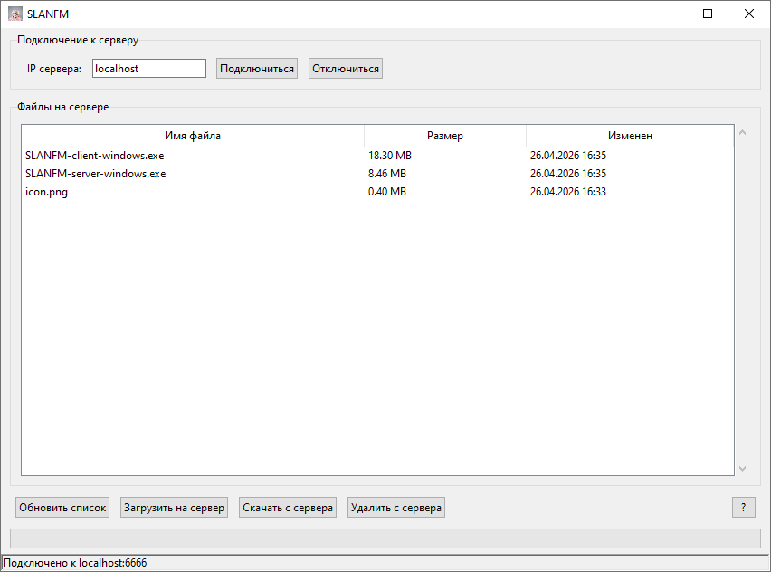
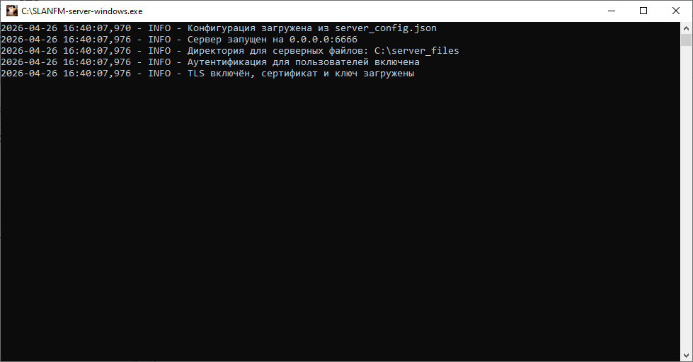

<h1 align="center"><b>SLANFM</b></h1>

<h4 align="center"><b>A simple client-server application for file transfer.</b></h4>

<h5 align="center">

[Русский](../README.md) | **English**

</h5>

## Installation and Launch

1. Go to the [releases page](https://github.com/Sandile225325/SLANFM/releases) and download the latest archive versions:
   - `SLANFM-client-windows.zip` – client;
   - `SLANFM-server-windows.zip` – server.

2. Extract each archive.

3. Run `SLANFM-server-windows.exe` to host the server.

4. Run `SLANFM-client-windows.exe` to use the client.

**OR**

1. Clone the repository and go to its root folder:

   ```
   git clone -b next https://github.com/Sandile225325/SLANFM.git
   cd SLANFM
   ```

2. Install the required libraries:

   ```
   pip install -r requirements.txt
   ```

3. Start the server:

   ```
   python server/server.py
   ```

4. Start the client:
   ```
   python client/gui.py
   ```

## Configuration

### Server

The server configuration is stored in the file **`server/server_config.json`**.

| Parameter                             | Type    | Description                                                                                                  |
| ------------------------------------- | ------- | ------------------------------------------------------------------------------------------------------------ |
| `host`                                | string  | IP address to listen on (`0.0.0.0` — all interfaces)                                                         |
| `port`                                | number  | Port on which the server runs                                                                                |
| `upload_dir`                          | string  | Path for storing files (can be relative or absolute)                                                         |
| `max_file_size`                       | number  | Maximum uploaded file size in bytes                                                                          |
| `chunk_size`                          | number  | Data block size during transfer in bytes                                                                     |
| `timeout`                             | number  | Socket timeout in seconds                                                                                    |
| `can_clients_delete_files`            | boolean | Whether to allow clients to delete files                                                                     |
| `auth_token`                          | string  | Token for client authentication. If an empty string or whitespace only — authentication is not required      |
| `tls_enabled`                         | boolean | Whether to use TLS encryption. If `false`, the `cert_file` and `key_file` parameters are ignored             |
| `cert_file`                           | string  | Path to the certificate file (required for TLS)                                                              |
| `key_file`                            | string  | Path to the private key file (required for TLS)                                                              |
| `max_json_size`                       | number  | Maximum JSON command size in bytes                                                                           |
| `auth_rate_limit_enabled`             | boolean | Whether to use brute-force token protection                                                                  |
| `auth_rate_limit_max_attempts`        | number  | How many failed authentication attempts from one IP are allowed per `auth_rate_limit_window` before blocking |
| `auth_rate_limit_window`              | number  | Window for counting failed attempts in seconds                                                               |
| `auth_rate_limit_lockout`             | number  | IP lockout duration in seconds after attempts are exhausted                                                  |
| `auth_rate_limit_failure_delay`       | number  | Delay in seconds before responding to an invalid token                                                       |
| `auth_rate_limit_global_max_attempts` | number  | Global limit of failed attempts from all IPs per `auth_rate_limit_global_window`                             |
| `auth_rate_limit_global_window`       | number  | Global limit window in seconds                                                                               |
| `ping_rate_limit_enabled`             | boolean | Whether to use ping rate limit protection                                                                    |
| `ping_rate_limit_max`                 | number  | How many ping requests from one IP are allowed per `ping_rate_limit_window`                                  |
| `ping_rate_limit_window`              | number  | Ping rate limit window in seconds                                                                            |
| `ping_min_interval`                   | number  | Minimum interval between ping requests from one IP in seconds                                                |
| `progress_log_unit`                   | string  | Unit for logging transfer progress. `percent` — as a percentage, `mb` — in megabytes                         |
| `progress_log_value`                  | number  | Interval value for progress logging in `progress_log_unit` units                                             |

### Client

The client configuration is stored in the file **`client/config.json`**.

| Parameter                           | Type    | Description                                                                                                        |
| ----------------------------------- | ------- | ------------------------------------------------------------------------------------------------------------------ |
| `connect_config.default_port`       | string  | Default port. Used if only an IP without `:port` is specified in the connection field                              |
| `connect_config.non-tls_timeout`    | number  | Connection timeout in seconds when operating without TLS                                                           |
| `connect_config.tls_timeout`        | number  | Connection timeout in seconds when operating with TLS                                                              |
| `values_config.chunk_size_range`    | array   | Valid chunk size range in bytes. If the server offers values outside the range — the client will refuse to connect |
| `values_config.timeout_range`       | array   | Valid timeout range in seconds. If the server offers values outside the range — the client will refuse to connect  |
| `input_save_config.ip`              | string  | Last entered IP address                                                                                            |
| `input_save_config.port`            | string  | Last entered port                                                                                                  |
| `authentication_config.token`       | string  | Token for authentication when connecting. Can be left empty for manual entry when connecting                       |
| `paths_config.download_dir`         | string  | Path for saving downloaded files (can be relative or absolute)                                                     |
| `status_bar_config.status_bar`      | boolean | Whether to show the status bar                                                                                     |
| `status_bar_config.show_connection` | boolean | Whether to show connection status in the status bar                                                                |
| `status_bar_config.show_rtt`        | boolean | Whether to show ping (RTT) in the status bar                                                                       |
| `ping_config.ping_enabled`          | boolean | Whether to enable periodic ping                                                                                    |
| `ping_config.ping_interval`         | number  | Interval between ping requests in seconds                                                                          |

### Generating a self-signed certificate and private key for TLS

To enable encryption, you can generate your own certificate and key using OpenSSL:

```
openssl req -x509 -newkey rsa:4096 -keyout private_key.key -out certificate.crt -days 3650 -nodes -subj "/CN=SLANFM"
```

After execution, the files **`private_key.key`** and **`certificate.crt`** will appear.

## Usage

### Server

The server runs in console mode. On startup, information about the host, port, server files folder, authentication, TLS, brute-force token protection, ping rate limiting, and progress logging is displayed.
During operation, client actions (uploads, downloads, deletions) are logged.

### Client

`Подключиться` (Connect) — connect to the specified server;  
`Отключиться` (Disconnect) — close the connection;  
`Обновить список` (Refresh list) — refresh the file list on the server;  
`Загрузить на сервер` (Upload to server) — select a local file and send it to the server;  
`Скачать с сервера` (Download from server) — select a file in the list and save it;  
`Удалить с сервера` (Delete from server) — delete the selected file (if allowed on the server);  
`?` — displays information about the version, connection, server parameters, or valid ranges.

## Screenshots




## License

[Apache-2.0 license](https://github.com/Sandile225325/SLANFM/blob/next/LICENSE)